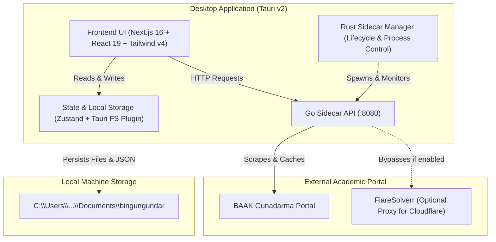

# bingungundar

Modern all-in-one desktop companion and academic dashboard for Universitas Gunadarma students.

[](https://tauri.app/)
[](https://nextjs.org/)
[](https://react.dev/)
[](https://golang.org/)
[](https://tailwindcss.com/)
[](LICENSE)

Aplikasi desktop offline-first untuk memantau jadwal kuliah, jadwal UTS, absensi, to-do list tugas, serta menyimpan catatan dan materi kuliah secara lokal di komputer tanpa ketergantungan pada server pihak ketiga.

---

## Daftar Isi

- [Fitur](#fitur)
- [Arsitektur](#arsitektur)
- [Tech Stack](#tech-stack)
- [Keamanan dan Privasi](#keamanan-dan-privasi)
- [Prasyarat](#prasyarat)
- [Instalasi dan Setup](#instalasi-dan-setup)
- [Menjalankan Aplikasi](#menjalankan-aplikasi)
- [Build Installer](#build-installer)
- [Struktur Proyek](#struktur-proyek)
- [Lisensi](#lisensi)

---

## Fitur

- **Jadwal Kuliah Cepat**: Pengambilan jadwal perkuliahan per kelas (misal: `1KA02`, `3IA01`) langsung dari portal BAAK dengan in-memory cache hingga 12 jam untuk akses instan.
- **Jadwal Ujian (UTS)**: Pencarian jadwal UTS otomatis berdasarkan kelas dengan fallback cache saat portal mengalami kendala trafik.
- **Attendance Tracker**: Pencatatan status kehadiran (Hadir, Izin, Sakit, Alpha) per mata kuliah beserta kalkulasi persentase otomatis.
- **Task Management**: Manajemen tugas akademik berbasis status (*To Do*, *In Progress*, *Done*) lengkap dengan batas tenggat waktu.
- **Catatan & Materi Kuliah**: Penyimpanan file dokumen materi dan catatan terorganisir per mata kuliah di direktori lokal (`Documents/bingungundar/`).
- **In-App File Preview**: Pratinjau dokumen langsung dari aplikasi (Word `.docx`, PDF, gambar, dan teks) serta integrasi tombol buka langsung ke Windows Explorer.
- **Modern Dark UI**: Antarmuka responsif berbasis tema gelap menggunakan Tailwind CSS dan komponen berbasis Shadcn/UI.

---

## Arsitektur

Aplikasi ini menggabungkan **Tauri v2 (Rust)** sebagai desktop shell, **Next.js 16 (React 19)** sebagai frontend antarmuka, dan **Go Sidecar** sebagai service scraping lokal:



- **Frontend**: Next.js App Router dengan Static Site Generation (`output: 'export'`) yang dimuat ke webview Tauri.
- **Backend Sidecar**: Binary Go mandiri yang dikelola siklus hidupnya oleh runtime Rust Tauri saat aplikasi dibuka dan ditutup.
- **Penyimpanan Lokal**: Mengutamakan `@tauri-apps/plugin-fs` untuk menyimpan data di direktori dokumen sistem operasi, dengan fallback `IndexedDB`.

---

## Tech Stack

| Komponen | Teknologi | Keterangan |
|---|---|---|
| Desktop Shell | [Tauri v2](https://tauri.app/) (Rust) | Native windowing, performa memori ringan, IPC & OS file plugin |
| Frontend Framework | [Next.js 16](https://nextjs.org/) + [React 19](https://react.dev/) | React Server Components & Static Site Export |
| Styling | [Tailwind CSS v4](https://tailwindcss.com/) | Modern OKLCH color spaces, responsif, dark mode |
| State Management | [Zustand v5](https://github.com/pmndrs/zustand) | Client-side reactive state dengan persistensi lokal |
| Data Fetching | [SWR](https://swr.vercel.app/) | Stale-while-revalidate data synchronization |
| File Parser | [Mammoth.js](https://github.com/mwilliamson/mammoth.js) | Viewer Word document (.docx) to HTML |
| Scraper Service | [Go (Golang)](https://golang.org/) | HTTP scraper, HTML parsing (GoQuery), TTL caching |
| Icons | [Lucide React](https://lucide.dev/) | Icon library |

---

## Keamanan dan Privasi

- **Tanpa Database Cloud**: Tidak ada data pengguna yang dikirim ke database eksternal atau server pihak ketiga.
- **Penyimpanan Lokal**: Seluruh data profil, jadwal, catatan, dan file disimpan langsung di perangkat pengguna.
- **Tanpa Kredensial Sensitif**: Aplikasi tidak menyimpan password atau kredensial akun portal kampus.

---

## Prasyarat

Sebelum menjalankan atau membangun proyek, pastikan dependensi berikut telah terpasang di sistem Anda:

- **Node.js**: Versi 20.x atau lebih baru
- **Package Manager**: [pnpm](https://pnpm.io/)
- **Rust & Cargo**: Versi 1.77+ ([Instalasi via rustup](https://rustup.rs/))
- **Go**: Versi 1.22+ (opsional, hanya diperlukan jika ingin memodifikasi atau kompilasi ulang binary `baak-api`)
- **C++ Build Tools**: Visual Studio C++ Build Tools (untuk pengguna Windows)

---

## Instalasi dan Setup

1. **Clone repository:**
   ```bash
   git clone https://github.com/username/bingungundar.git
   cd bingungundar
   ```

2. **Instal dependensi frontend:**
   ```bash
   pnpm install
   ```

3. **(Opsional) Kompilasi binary Go sidecar:**
   Jika Anda mengubah kode scraper pada direktori `baak-api/`, kompilasi ulang binary sidecar untuk Windows:
   ```bash
   cd baak-api
   go build -o ../src-tauri/binaries/baak-api-x86_64-pc-windows-msvc.exe main.go
   cd ..
   ```

---

## Menjalankan Aplikasi

Jalankan mode development:

```bash
pnpm tauri dev
```

Perintah ini akan menjalankan:
1. Server lokal Next.js di `http://localhost:3000`.
2. Sidecar service `baak-api` di latar belakang.
3. Jendela desktop aplikasi Tauri.

---

## Build Installer

Untuk menghasilkan installer biner siap pakai (Windows `.exe` / `.msi`):

```bash
pnpm tauri build
```

Hasil installer biner akan tersedia pada direktori:
```text
src-tauri/target/release/bundle/nsis/
```

---

## Struktur Proyek

```text
bingungundar/
├── baak-api/              # Service backend Go (Scraper portal BAAK & caching)
│   ├── config/            # Konfigurasi port, cache TTL, & endpoint
│   ├── handlers/          # HTTP handlers (jadwal, UTS, kalender)
│   ├── models/            # Model dan skema data Go
│   └── utils/             # Logika parser GoQuery & circuit breaker
├── src-tauri/             # Desktop core Tauri v2 (Rust)
│   ├── binaries/          # Prebuilt binary sidecar
│   ├── icons/             # Ikon aplikasi
│   ├── src/               # Rust source code (lib.rs & main.rs)
│   └── tauri.conf.json    # Konfigurasi aplikasi & permissions Tauri
├── src/
│   ├── app/               # Next.js App Router
│   ├── components/        # Komponen UI, dialog, & file previewer
│   ├── hooks/             # Custom React hooks
│   ├── lib/               # Storage adapters & utility functions
│   └── store/             # Zustand stores
├── public/                # Asset statis & logo
├── package.json
└── README.md
```

---

## Lisensi

Didistribusikan di bawah [Lisensi MIT](LICENSE).

---

<div align="center">
Dibuat oleh <b>Akmal Ghanim</b> untuk mahasiswa Universitas Gunadarma.
</div>
